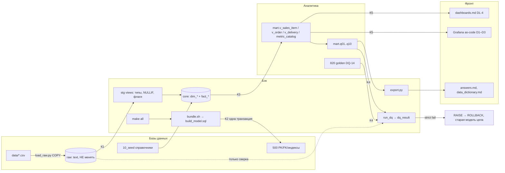
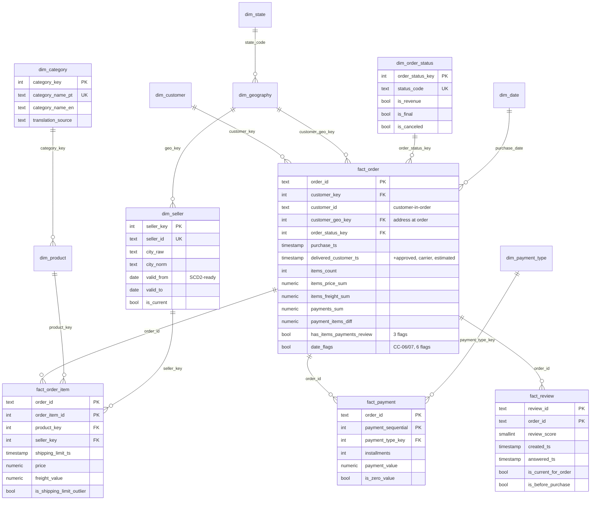
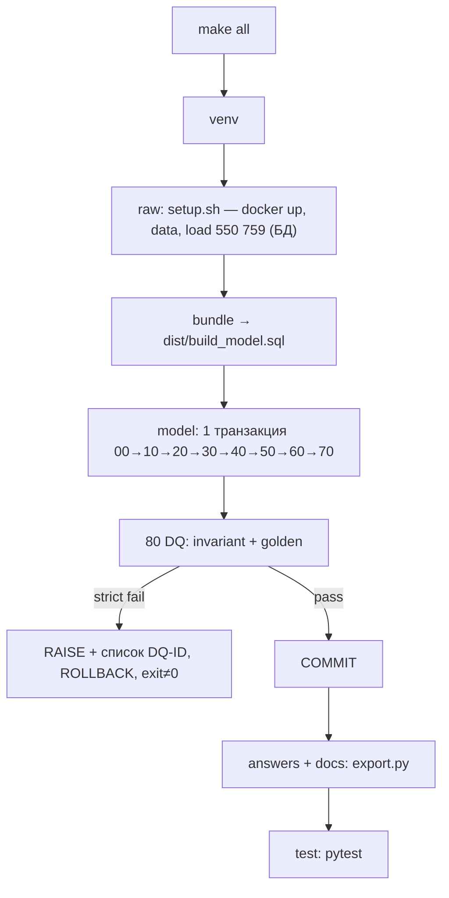

# Архитектура baseline: модель маркетплейса Capibara

v0.2 (Design), 2026-10-28. Требования — `docs/TZ.md` (§ — его разделы). Решения человека — **DECISION-N**, непроверенное — **ASSUMPTION-N** (= A-N в §g).

## a) Стек

| Задача | Выбор | Почему | Отвергнуто |
|---|---|---|---|
| БД | PostgreSQL 16 (окружение кейса как есть) | требование; 550k строк — секунды | DuckDB/ClickHouse: проверка через psql (ORG-4) |
| Трансформации | **чистый SQL**: `sql/NNN_*.sql` → один `dist/build_model.sql` | DL-1 = «SQL-скрипт с нуля»; без Jinja всё объяснимо | dbt-core: экспорт ≠ исполняемому (`target/run` без rename/тестов); SQLMesh: избыточен для ~25 объектов |
| Оркестрация | **make** + `scripts/bundle.sh` | есть везде, граф линейный | just — установка; Dagster/Airflow — сервер ради 10 с |
| DQ в сборке | **реестр проверок как данные** + `mart.run_dq()` | громко в сборке (NFR-03), журнал — таблица | great_expectations — тяжёлый; dbt tests — только с dbt |
| Мета-тесты | **pytest** + psycopg2 (драйвер `load_raw.py`) | идемпотентность, «нет `raw.`», CC-ID, функции | дубли DQ — два источника истины |
| Линт | **sqlfluff** (postgres, templater raw) | NFR-02 автоматически | ручной стиль |
| CI | GitHub Actions + service postgres:16 (DECISION-6) | «с нуля» доказано | GitLab — нет remote |
| Docs/lineage | `COMMENT ON` → `docs/data_dictionary.md`; mermaid здесь | виден в DBeaver, без сервера | dbt docs |
| Фронт | DL-4 + Grafana OSS as-code (запасной Streamlit) — `docs/dashboards.md` | воспроизводимо из git, macOS, бесплатно (DECISION-9/10) | Power BI (нет macOS), Metabase (не as-code), Superset (тяжёлый) |
| API | не нужен | ответы — views + CSV | FastAPI — лишний код |

ASSUMPTION-1: Python 3.12, pytest 8.x, psycopg2-binary 2.9.x, sqlfluff 3.x, streamlit 1.x — пины в W0.

**ADR-1. SQL + make вместо dbt.** DL-1 = файл, который гоняют тесты. Минус (нет `ref()`, dbt docs) закрывают префиксы + тест уникальности + `COMMENT ON`. dbt — шаг роста в DL-5.
**ADR-2. Одна транзакция, полная пересборка.** `BEGIN; DROP SCHEMA stg,core,mart CASCADE; …; CALL mart.run_dq(); COMMIT;` DDL транзакционен: при сбое остаётся **прежняя** модель; идемпотентность (NFR-01) — следствие. Без psql-метакоманд (A-3).
**ADR-3. DQ — данные.** Строка `(check_id, dq_ref, cc_ref, kind, sql, expected, tolerance)`; `run_dq()`: `EXECUTE … EXCEPTION` → `pass/fail/error` («нет объекта» в W1 = правильный красный). `kind`: `invariant` (сверка с raw, PK, FK, суммы — живут при новых данных) / `golden` (DQ-14). GUC `capibara.dq_mode`: `strict` (RAISE со списком ID) / `report`.
**ADR-4. Звезда, 4 атомарных факта** (заказ, позиция, платёж, отзыв) не соединяются между собой без агрегации (FR-06). Заказные агрегаты в `fact_order` считаются **из** `fact_order_item`/`fact_payment`.
**ADR-5. Выручка в одном месте:** флаги — seed `core.dim_order_status`; меры — `mart.v_sales_item`. Ответы ссылаются только на них (FR-16, FR-31).

## Логические блоки

| | **Базы данных (БД)** | **Бэк** | **Аналитика (Ан)** | **Фронт (Фр)** |
|---|---|---|---|---|
| Назначение | хранение, схема, целостность | сборка и проверка одной командой | меры, ответы, контроли | показ результатов |
| Компоненты | PG16 в docker, init, `load_raw.py`, схемы, seeds (10_), PK/FK/индексы (500), `COMMENT ON`, роль `analyst` (RO) | Makefile, bundle.sh, stg (20_), dim/fact (30_, 40_), DQ-раннер (800/810/890), export.py, pytest, sqlfluff, CI | mart.v_* (60_), `metric_catalog`, q01..q10 (70_), golden (820), DL-2, DL-3 | `dashboards.md` (D1 продажи, D2 доставка/SLA, D3 покупатели), Grafana as-code, `answers.md`, словарь |
| Технологии | PostgreSQL 16, Docker, psycopg2 | SQL, bash, make, Python, GitHub Actions | SQL (views, window functions) | Markdown, Grafana OSS / Streamlit |
| Вход → выход | CSV → raw.* (550 759), схемы, ограничения | raw, sql/** → stg, core, dist, dq_result | core → mart, answers | mart → DL-4, дашборды |
| Владелец | devops, python-developer | python-developer, tester, devops | python-developer, tester | frontend-developer, команда |

**Контракты** (фиксируются здесь до кода):
- **К1 БД→Бэк:** 8 таблиц `raw.*` (text, `02_raw_ddl.sql`), подключение из `.env`.
- **К2 Бэк→БД:** `dist/build_model.sql` — единственный писатель stg/core/mart.
- **К3 Бэк→Ан:** звезда `core` (имена, гранулы, ключи — §c) + флаги `dim_order_status`.
- **К4 Ан→Бэк:** `mart.qNN_*` и golden-строки в `dq_check_def`, исполняет раннер.
- **К5 Ан→Фр:** 7 views `mart.v_*` + `metric_catalog` (колонки и гранулы — `dashboards.md` §3) + `answers/*.csv`; фронт читает только mart.

## b) Скелет проекта (по блокам)

```
hack/
├── CLAUDE.md  README.md (кейса + «Сборка модели»)  .env.example  .gitignore
│
├── [БД]  docker-compose.yml                 из кейса, НЕ менять
│         scripts/setup.sh, download_data.sh, load_raw.py, init/*.sql   из кейса, НЕ менять
│         sql/00_setup/000_schemas.sql       DROP/CREATE stg,core,mart; unaccent; роль analyst (опц.)
│         sql/10_seed/100_dim_state  110_dim_order_status  120_dim_payment_type
│                     130_ref_city_fix  140_ref_category_extra (DECISION-5)
│         sql/50_constraints/500_pk_fk_indexes.sql
│
├── [Бэк] Makefile  requirements-dev.txt  .sqlfluff  .github/workflows/ci.yml
│         scripts/bundle.sh                  sort sql/** → dist/build_model.sql (BEGIN/COMMIT, маркеры)
│         scripts/export.py                  answers/*.csv, answers.md, dq_report.md, data_dictionary.md
│         sql/00_setup/010_functions.sql     fn_normalize_city, fn_zip5
│         sql/20_staging/200..270_stg_*.sql  views: типы, NULLIF/TRIM, флаги CC
│         sql/30_core_dim/300..360_dim_*.sql
│         sql/40_core_fact/400..430_fact_*.sql
│         sql/80_dq/800_dq_framework  810_dq_invariants  890_dq_run
│         tests/conftest  test_dq  test_static  test_idempotency  test_functions
│         dist/build_model.sql               DL-1, генерируется, коммитится
│
├── [Ан]  sql/60_mart/600_v_sales_item 610_v_order 615_v_payment 620_v_delivery(+_item) 630_metric_catalog 640_v_customer 650_v_cohort_retention
│         sql/70_answers/701_q01..705_q05;   706..710 резерв Q6–Q10
│         sql/80_dq/820_dq_golden.sql        DQ-14
│         answers/q01..q10.csv, dq_report.md DL-2 (генерируются, коммитятся)
│         docs/decisions.md                  DL-3 ≤ ½ A4
│
├── [Фр]  docs/dashboards.md                 DL-4: выбор BI, D1–D3, контракт К5
│         docker-compose.bi.yml              grafana, profile tools (compose кейса не трогаем)
│         dashboards/grafana/{provisioning,json}/  dashboards/streamlit/app.py (запасной)
│         answers/answers.md, docs/data_dictionary.md
│
└── [общее] docs/architecture.md, strategy.md (DL-5), ai_usage.md (DL-6, журнал по checkpoint);
            входы TZ.md, tz/, handout.md, tasks.md, profiling/ — не менять; hack.ipynb — вне пайплайна
```

Шапка каждого SQL-файла (NFR-04, проверяет `test_static.py`):
```sql
-- object : core.fact_order_item
-- grain  : 1 строка = 1 единица товара продавца в заказе; PK (order_id, order_item_id)
-- source : stg.order_items, core.dim_product, core.dim_seller
-- cc     : CC-09 (order_item_id — номер), CC-08 (shipping_limit 2020 → флаг)
-- why    : <решение одной фразой>
```

## c) Архитектура



Правила: raw читают только stg и DQ; `mart.q*` — только `mart.v_*` и core (FR-01). Имена всегда со схемой (в CI нет `search_path`).


Остальные измерения: `dim_customer(customer_key, customer_unique_id UK)`, `dim_product(product_key, product_id UK, category_key, name_length ← lenght, weight_g, is_missing_dims)`, `dim_geography(geo_key, zip5, city_norm, state_code)`, `dim_state(state_code, state_name, region)`, `dim_payment_type(payment_type_key, code UK, is_defined)`, `dim_date(date_day PK, month_start, year, month; 2016-01-01..2020-12-31, ASSUMPTION-8)`.

| Объект | Гранула / PK | Ожидание |
|---|---|---|
| fact_order | заказ / order_id | 99 441; без позиций 775, без платежей 1, без отзывов 768 |
| fact_order_item | единица товара (AS-06) / (order_id, order_item_id) | 112 650; Σprice 13 591 643.70; Σfreight 2 256 599.44 |
| fact_payment | платёж / (order_id, payment_sequential) | 103 886; Σ 16 008 872.12 |
| fact_review | отзыв×заказ / (review_id, order_id) | 99 224; ровно 1 `is_current` на заказ с отзывом |
| dim_customer / dim_category / dim_order_status | человек / категория / статус | 96 096 / 73+unknown=74 / 8+unknown |

**Соглашения.** Ключи `int` = `row_number() OVER (ORDER BY natural_key COLLATE "C")` (DECISION-3); **unknown-member** `-1` в каждом dim (DQ-01 его не считает). `numeric(12,2)`, `timestamp`, `date`, `boolean NOT NULL` (`is_`/`has_`). Адрес покупателя — в заказе (`customer_geo_key`, 252 человека с разными адресами — история без SCD). Strict-cast: пустое → NULL, мусор роняет сборку (A-6).

| CC | Решение | Где |
|---|---|---|
| 01, 16 | покупатель = unique_id; 290 одновременных — повтор (ORG-2) | dim_customer |
| 02, 03 | заказ остаётся, `has_items/has_payments/has_review` (FR-26) | fact_order |
| 04 | календарь dim_date, период — явный в view | dim_date, q01 |
| 05 | справочник статусов с флагами | dim_order_status |
| 06, 07 | как в raw + 6 флагов; сроки по валидным парам | stg_orders, v_delivery |
| 08 | `is_shipping_limit_outlier` (год ≥ 2020) | fact_order_item |
| 09 | PK (order_id, order_item_id); units = count(*) | fact_order_item |
| 10, 11 | нули, not_defined храним; расхождение — `payment_items_diff` + DQ-09 | fact_payment, fact_order |
| 12 | PK пары; актуальный — max(created_ts) → max(answered_ts) → review_id (DECISION-4) | stg_order_reviews |
| 13 | UNION товаров и перевода; пустая → unknown; 2 без перевода → `missing` | dim_category |
| 14 | `NULLIF(TRIM(x),'')` во всём stg | 20_staging |
| 15 | `fn_normalize_city` (lower, unaccent, обрезка после `/` `,` ` - `) + таблица правок; `city_raw` храним; `fn_zip5` = lpad 5 | 010, 130, dim_geography |

### Определение выручки (дало контроли, FR-30 / §7.1)
- **Выручка** (Q-1, Q-2, Q-5) = `SUM(fact_order_item.price)` по заказам с `dim_order_status.is_revenue` (только `delivered`); **без freight**; уровень позиции; месяц `date_trunc('month', fact_order.purchase_ts)`; период `[2016-09-01, 2018-09-01)` → **13 221 498.11**, 24 месяца, 2016-11 = 0.
- **Средний чек** (Q-3) = `AVG(items_price_sum + items_freight_sum)` по 96 478 delivered-заказам = **159.88** (**с** freight); строк = единиц = 1.1422.
- **Покупатели** (Q-4): **все** 99 441 заказа, все статусы → 96 096 unique_id, 2 997 с 2+ = **3.12 %**.
- Ловушки, ловит DQ: все статусы 13 591 498.70; price+freight 15 424 463.65; INNER JOIN к переводу 13 045 530.90; customer_id 99 441. Различия Q-3/Q-4 — в `metric_catalog` и `decisions.md` (AS-05).

## d) Пайплайн



| Шаг | Команда | Вход → выход | Успех / падение |
|---|---|---|---|
| 0 | `make venv` | requirements-dev → .venv | зависимости ставятся |
| 1 | `make raw` (= `setup.sh`; `reset` = `--reset`) | CSV → raw.* | 550 759 строк |
| 2 | `make lint` | sql/** | 0 нарушений sqlfluff |
| 3 | `make bundle` | sql/** → dist | префиксы уникальны, нет `\`-метакоманд |
| 4 | `make model` | dist + raw → stg/core/mart | exit 0; DQ-fail → exit≠0, старая модель цела |
| 5 | `make dq` | dq_result → консоль | все `pass` (диагностика: `DQ_MODE=report`) |
| 6 | `make answers docs` | mart → answers/*, словарь | итоги = контролям; комментарии у всех колонок |
| 7 | `make test` | БД + репо | pytest зелёный |
| 8 | `make bi` (опц.) | mart → Grafana :3000 | 3 дашборда без логина, KPI = answers |
| — | `make all` / `make ci` | чистая машина: docker, python3, make | < 3 мин; повтор → тот же fingerprint; ci + `git diff --exit-code dist answers` |

`PSQL` = `docker compose exec -T postgres psql -U hack -d marketplace -X -q -v ON_ERROR_STOP=1` (локальный psql не нужен); в CI — `psql postgresql://…@localhost`. CSV не в git, CI качает (A-4).

**DQ:** 01 строки raw = core (динамически); 02 строк до/после JOIN поровну + 775/1/768; 03 дубли PK 0; 04 96 096/2 997; 05 q01 24 строки, 2016-11 = 0; 06 Σ месяцы = категории = продавцы = итог; 07 Σprice/Σfreight после JOIN не меняются; 08 висящих FK 0; 09 Σплатежей, 447 расхождений; 10 флаги CC-06..08; 11 74 категории; 12 штат ∈ dim_state, zip5; 13 пустых строк в text core 0; 14 golden Q-1..Q-5; **15** (сверх ТЗ) статусы и способы оплаты из raw есть в справочниках.

## e) Вброс и Q6–Q10

Точки расширения: флаги seed 110; меры и роли дат в `v_sales_item`; `v_delivery`; `metric_catalog`; резерв 706–710; реестр DQ.

**Шаблон нового вопроса (≈ 10–15 мин):** (1) гранула и мера → `metric_catalog`; нет меры — строка в каталоге + колонка в `v_*`, факты не трогаем; (2) копия `701_*.sql` → `70N_qNN_<slug>.sql`; (3) есть контроль → сначала строка в `820` (красный), потом view; (4) `make bundle model answers test`; (5) новое определение → `decisions.md`, `ai_usage.md`.

| Сценарий | Что меняем | Факты |
|---|---|---|
| Выручка с freight | ответ на `gross_value` | нет |
| +shipped / «минус отмены» для **всех** | флаг `is_revenue` в 110; golden падают → новые ожидания с записью | нет |
| Только для **новых** вопросов (ORG-7) | флаг `is_revenue_v2` + мера | нет |
| Месяц по вручению | `delivered_month` уже есть (25 месяцев) | нет |
| Новый статус | строка в seed; до этого DQ-15 падает, строки → unknown | нет |
| Возвраты | `fact_return` (единица, FK на (order_id, order_item_id)) + DQ | +1 файл |
| Купоны | `dim_promo` ↔ `fact_payment` (voucher) | +1 колонка |
| Продавец переехал | `dim_seller` → SCD2 (valid_from/to уже есть), lookup по purchase_ts | lookup в 400 |
| Отзывы по продавцу | `fact_review(is_current)` → заказ → позиции (1 278 мультипродавцовых — НА) | нет |
| Новые данные | `make raw model`: invariant ок, golden падают = сигнал | пересборка |

**SCD2:** `dim_seller` (адрес), `dim_product` (категория); `dim_category` — SCD1; версии выручки — флаги `*_vN`; адрес покупателя исторический (в заказе).

## f) Волны (TDD)

Исп.: pd python-developer, pdl python-developer-lite, t tester, cr code-reviewer, se security-engineer, do devops, fd frontend-developer. W6d «Дашборды» — опциональная (DECISION-9). ∥ — параллельно внутри волны (файлы разные). ⇄ — параллельно между блоками после фиксации контракта К1–К5.

| ID | В | Блок | Описание | Файлы | Завис. | Исп. | Тег |
|---|---|---|---|---|---|---|---|
| T01 | 0 | БД | venv-зависимости, игнор, .env | .gitignore, .env.example, requirements-dev.txt | — | do | lite ∥ |
| T02 | 0 | Бэк | Makefile (цели §d, PSQL), bundle.sh, .sqlfluff | 3 файла | — | do | std ∥ |
| T03 | 1 | Бэк | DQ-каркас + run_dq (strict/report); DQ-01..13, 15 | 800, 810, 890 | T02 | t | std ∥⇄ |
| T04 | 1 | Ан | golden DQ-14 по контракту К3/К4 | 820 | T02 | t | std ∥⇄ |
| T05 | 1 | Бэк | pytest: test_dq, test_static (нет `raw.` в 60/70, шапки, CC-01..16, префиксы), test_idempotency, test_functions | tests/* | T02 | t | std ∥ |
| T06 | 1 | БД | 000_schemas (+unaccent, роль analyst опц.), 010_functions | 00_setup/* | T02 | pd | std ∥ |
| T07 | 2 | БД | seeds: штаты, статусы с флагами, способы оплаты | 100–120 | T06 | pd | std ∥ |
| T08 | 2 | Бэк | ref_city_fix (34 случая), stg_sellers, stg_customers | 130, 250, 260 | T06 | pd | std ∥ |
| T09 | 2 | Бэк | паттерн staging: stg_orders (флаги CC-06/07), stg_order_items (CC-08/09) | 200, 210 | T06 | pd | std ∥ |
| T10 | 3 | Бэк | stg_order_reviews: правило актуального (CC-12) | 230 | T09 | pd | std ∥ |
| T11 | 3 | Бэк | stg_order_payments, stg_products (`lenght`→`length`), stg_category_translation по паттерну 200 | 220, 240, 270 | T09 | pdl | lite ∥ |
| T12 | 3 | Бэк | dim_date, ref_category_extra (DECISION-5) | 300, 140 | T06 | pd | std ∥ |
| T13 | 4 | Бэк | dim_geography, dim_seller (SCD2-ready) | 320, 330 | T08 | pd | std ∥ |
| T14 | 4 | Бэк | dim_category, dim_product | 340, 350 | T11, T12 | pd | std ∥ |
| T15 | 4 | Бэк | dim_customer (CC-01, 16) | 360 | T08 | pd | std ∥ |
| T16 | 5 | Бэк | fact_order_item, fact_payment | 400, 410 | W4 | pd | std ∥ |
| T17 | 5 | Бэк | fact_review | 420 | T10 | pd | std ∥ |
| T18 | 5 | Бэк+БД | fact_order (агрегаты по К3), 500_pk_fk_indexes | 430, 500 | W4 | pd | std ∥ |
| T19 | 6 | Ан | все 7 views К5 + metric_catalog | 600–650 | W5 | pd | std ∥ |
| T20 | 6 | Бэк | export.py + цели answers/docs | export.py, Makefile | W5 | pd | std ∥⇄ |
| T21 | 6b | Ан | ответы q01..q05 | 701–705 | T19 | pd | std |
| T27 | 6d | Фр | docker-compose.bi.yml, provisioning, `make bi` | 3 файла | T19 | do | std ∥ |
| T28 | 6d | Фр | D1 продажи (JSON) | d1_sales.json | T27 | fd | std ∥ |
| T29 | 6d | Фр | D2 доставка/SLA/отзывы, D3 покупатели | d2_*.json, d3_*.json | T27 | fd | std ∥ |
| T30 | 6d | Фр | test_dashboards: rawSql выполняются, KPI = golden | tests/test_dashboards.py | T19 | t | std ∥ |
| T23 | 7 | все | ревью diff против architecture.md | — | W6 | cr | — ∥ |
| T24 | 7 | Бэк | CI + «чистый клон → make all» | ci.yml | W6 | do | std ∥ |
| T25 | 7 | БД | аудит секретов, экспортов, прав роли | — | W6 | se | — ∥ |
| T26 | 8 | Ан | Q6–Q10/вброс: golden (t) → view по §e (pd); lite, если копия 701 без новой меры | 706–710, 820 | W6 | t→pd | std/lite |

⇄ T04 ∥ T03/T05 (К3/К4 зафиксированы здесь); T20 ∥ T19; вся W6d ∥ T21 и W7 (К5 после T19). Задачи команды (55 баллов этапов 5–7, старт с W4 ⇄ всему): `decisions.md` (DL-3), `dashboards.md` (DL-4, черновик готов), `strategy.md` (DL-5), `ai_usage.md` (DL-6: что делал ИИ, чем проверили, что решили сами — пополняется на каждом checkpoint).

| Checkpoint | Проверка | Критерий |
|---|---|---|
| W0 | `make reset raw bundle lint` | raw = 550 759; dist с BEGIN/COMMIT; sqlfluff запускается |
| W1 | `make model DQ_MODE=report`, `make test` | сборка доходит до конца; DQ = error «нет объекта»; тесты красные |
| W2 | report + SELECT из stg | stg_orders 99 441, stg_order_items 112 650 без ошибок cast; test_functions зелёный |
| W3 | то же | 8 stg читаются; 1 актуальный отзыв на заказ |
| W4 | DQ-01 (dim), 03, 11, 12, 13 | зелёные; dim_customer 96 096; dim_category 74 |
| W5 | DQ-01..10, 13, 15 | зелёные; strict не падает на invariant |
| W6/6b | `make all test` | все DQ включая golden = pass; answers/* есть; idempotency зелёный |
| W6d (опц.) | `make bi`, test_dashboards | 3 дашборда без логина; KPI «Выручка» = 13 221 498.11; тест зелёный |
| W7 | ревью, CI, аудит | замечания закрыты; CI зелёный |
| W8 | каждый Q6–Q10 | golden красный → view → зелёный; запись в decisions и ai_usage |

## g) Решения для человека, допущения, риски

| ID | Вопрос | Варианты | Рекомендация |
|---|---|---|---|
| **DECISION-1** | Трансформации | (A) SQL + make; (B) dbt + экспорт; (C) dbt + ручной SQL | **A**: DL-1 нативен; B — экспорт ≠ исполнению; C — два источника |
| **DECISION-2** | Staging | (A) схема `stg` (views); (B) `core.stg_*`; (C) CTE в файлах core | **A**: core чист; raw/core/mart сохранены |
| **DECISION-3** | Ключи dim | (A) int row_number; (B) натуральные text; (C) md5→bigint | **A** (SCD2-ready); ключи сдвигаются при новых данных → DL-5: key-map |
| **DECISION-4** | Актуальный отзыв (547 заказов, у 202 разные оценки) | (A) последний; (B) первый; (C) средняя оценка | **A**; все сырые отзывы остаются в факте |
| **DECISION-5** | pc_gamer, portateis_… (ORG-3) | (A) en = pt, `missing`; (B) ручной перевод `manual`; (C) NULL | **A** до ответа организаторов |
| **DECISION-6** | CI | (A) GitHub Actions при наличии remote; (B) только `make ci` | **A**, если репо публикуется, иначе B |
| **DECISION-7** | «Заказов» в Q-1 | (A) delivered + «всего»; (B) все | **A** |
| **DECISION-8** | Сборка | (A) 1 транзакция; (B) autocommit | **A** |
| **DECISION-9** | Делать ли живой дашборд | (A) только DL-4; (B) DL-4 + W6d | **B**, если W6 закрыт к середине хакатона, иначе A |
| **DECISION-10** | BI-инструмент | Grafana / Streamlit / Superset / Metabase (`dashboards.md` §1) | **Grafana** основной, **Streamlit** запасной |

| ID | Допущение |
|---|---|
| A-1 | версии §a закрепляются в W0 |
| A-2 | в `postgres:16-alpine` есть contrib `unaccent`, `hack` — суперпользователь; запасной вариант `translate()` |
| A-3 | DL-1 запускают через psql или DBeaver → без метакоманд |
| A-4 | CSV не в git (61 МБ, CC BY-NC-SA); CI качает |
| A-5 | строка items = 1 единица (AS-06) |
| A-6 | strict-cast: мусор роняет сборку |
| A-7 | месяц выручки по purchase (ORG-1); delivered_month параллельно |
| A-8 | dim_date 2016-01-01..2020-12-31 (CC-08) |
| A-9 | `grafana/grafana-oss:11.x`, плагин PG встроен |

**Риски:** R-A1 порядок файлов → тест префиксов. R-A2 golden ломаются на вбросе → invariant/golden раздельно, смена ожиданий только с записью. R-A3 транзакция прячет прогресс → report + маркеры в RAISE. R-A4 этапы 5–7 отстают → документы с W4. R-A5 команда не объяснит SQL от ИИ → «why» в шапках, T23, DL-6.
