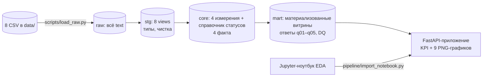
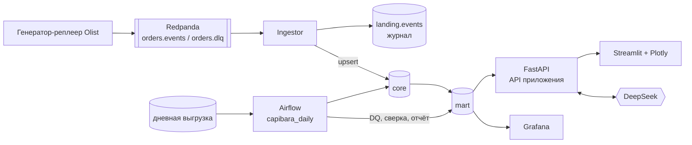

# Capibara: отчёт о бэкенде — что есть сейчас и куда идём

Документ для команды и для загрузки в NotebookLM как источник для презентации. Он самодостаточен: все термины объяснены внутри, ссылки на другие файлы — только для справки. Дата: 28.10.2026. Цифры в разделах «как сейчас» сняты с работающей базы, а не взяты из планов.

---

## 1. Коротко (для первого слайда)

- **Задача кейса.** Маркетплейс Capibara (реальные обезличенные данные бразильского Olist, 8 файлов, 550 759 строк, сентябрь 2016 – октябрь 2018) копил данные из разных подсистем. Отчёты у аналитиков не сходились. Нужно построить модель данных, на которую можно опереться, и отвечать на вопросы аналитиков из неё.
- **Что сделано.** Модель собирается из сырых данных одним SQL-скриптом за ~3 секунды на чистой базе. Внутри одна транзакция: либо собралось всё и прошли все проверки, либо не изменилось ничего. 25 автоматических проверок качества, включая контрольные цифры всех пяти вопросов первого блока, проходят до копейки. Поверх модели работает веб-приложение с KPI и графиками, всё поднимается одной командой `make demo`.
- **Куда идём.** Превращаем разовую сборку в живой сервис: новые заказы приходят потоком через брокер Redpanda и сразу видны на интерактивных графиках (Streamlit + Plotly). Каждую ночь Airflow пересобирает модель с нуля, проверяет и сверяет с потоком. Аналитики работают в Grafana, а ИИ-агент на DeepSeek строит график по вопросу на естественном языке.
- **Главная идея для защиты.** Одна модель — два пути данных. Онлайн-цифры оперативные, ночные — окончательные, и каждую ночь сверка доказывает, что они совпали.

---

## 2. Исходная ситуация и требования заказчика

### 2.1 Как устроен бизнес

Площадка сводит продавцов и покупателей. Продавец размещает карточку товара. Покупатель оформляет заказ, в нём может быть несколько товаров от разных продавцов. Каждый продавец отгружает свою часть сам, у него есть крайний срок отгрузки. Площадка фиксирует передачу в доставку и вручение. После получения покупатель может оставить отзыв.

### 2.2 Исходные данные (8 файлов)

| Таблица | Строк | Что в ней | Важные особенности |
|---|---|---|---|
| orders | 99 441 | заказ и вся его хронология: оформлен, оплачен, передан в доставку, вручён, обещанная дата | 8 статусов; у 8 заказов статус «вручён», а даты вручения нет |
| order_items | 112 650 | позиции заказа: товар, продавец, цена, доставка, срок отгрузки | `order_item_id` — порядковый номер внутри заказа, а не идентификатор |
| order_payments | 103 886 | платежи; один заказ может быть оплачен несколькими способами | рассрочка; бывает 0 частей рассрочки |
| order_reviews | 99 224 | отзывы, оценка 1–5 | `review_id` не уникален; у 547 заказов несколько отзывов |
| products | 32 951 | карточки товаров | у 610 товаров нет категории; опечатка `lenght` в названиях колонок |
| sellers | 3 095 | продавцы: город, штат, индекс | города в разном написании |
| customers | 99 441 | покупатели | два идентификатора: `customer_id` (99 441, меняется от заказа к заказу) и `customer_unique_id` (96 096, это и есть человек) |
| category_translation | 71 | перевод категорий с португальского | 2 категории товаров без перевода |

### 2.3 Правила игры от заказчика

- Сырые данные (схема `raw`) менять нельзя. Модель строится в схеме `core`, витрины и ответы — в `mart`.
- Ответы должны считаться из модели, а не из сырых данных.
- Сборка воспроизводима: один скрипт, чистая база, отрабатывает целиком.
- 5 вопросов выдали в начале, ещё 5 и «вброс» (изменение требований) — в середине хакатона. Модель не должна быть подогнана под известные вопросы.
- Сдаём: SQL-скрипт сборки, ответы с цифрами, записку о решениях на полстраницы, концепцию дашборда, стратегию развития. Использование ИИ разрешено, но его надо объяснить.
- Шкала оценки (140 баллов): правильность ответов 30, качество модели 30 (гранулярность фактов, ключи, пропуски и статусы, справочники), поддерживаемость 15 (воспроизводимость, единообразие, самопроверки, прозрачность), понимание и реакция на вброс 25, концепция дашборда 20, использование ИИ 15, стратегия развития 20.

---

## 3. Бэкенд сейчас: общая картина

Словами: CSV загружаются в `raw` как есть, все колонки текстом. Дальше один SQL-скрипт проходит слои `stg` → `core` → `mart`, считает ответы на вопросы и прогоняет проверки качества. Веб-приложение читает только витрины `mart` и рисует страницу.

### 3.1 Технологии

| Что | Чем | Почему |
|---|---|---|
| База | PostgreSQL 16 (alpine) в Docker | требование кейса; DDL в Postgres транзакционный — это позволяет собирать модель «всё или ничего» |
| Трансформации | чистый SQL, 28 файлов | сдаётся «SQL-скрипт сборки», команда должна уметь объяснить каждую строку на защите; dbt и SQLMesh рассмотрели и отвергли как лишний слой, который пришлось бы объяснять |
| Склейка и запуск | Python 3.12: `pipeline/bundle.py`, `pipeline/run_etl.py` | склеить файлы по порядку и выполнить одним вызовом |
| Оркестрация | Makefile + docker compose | одна команда `make demo`, без ручных шагов |
| Приложение | FastAPI + Jinja2 + matplotlib | минимальный веб-слой поверх витрин |
| Контейнеры | один образ `python:3.12-slim` для ETL и приложения, код монтируется из репозитория | нативно на Apple Silicon, правки кода видны без пересборки образа |

### 3.2 Как запускается (одна команда)

`make demo` поднимает три сервиса по цепочке:
1. **postgres** — база; при первом старте создаёт схемы и таблицы `raw` скриптами кейса.
2. **etl** — одноразовый контейнер: ждёт базу → если `raw` пустой, загружает CSV → склеивает SQL → собирает модель → печатает отчёт проверок → импортирует графики из ноутбуков → завершается.
3. **app** — стартует только если `etl` завершился успешно (`service_completed_successfully`). Открывается на http://localhost:8000.

Другие команды: `make etl` (пересобрать модель; `FORCE_RAW=1` — перезалить сырые данные, `DQ_MODE=report` — не откатывать при упавших проверках), `make bundle` (только склеить скрипт), `make notebook`, `make reset` (снести базу и собрать всё заново), `make logs`, `make down`.

Кейсовый `docker-compose.yml` не меняли: наши сервисы лежат в отдельном `docker-compose.app.yml`, который подключается поверх.

---

## 4. Слои модели подробно

### 4.1 Порядок сборки

SQL-файлы лежат в `sql/` с числовыми префиксами; порядок префиксов — это порядок выполнения:

| Префикс | Слой | Что делает |
|---|---|---|
| 000 | setup | удаляет и заново создаёт схемы `stg`, `core`, `mart` (raw не трогает) — поэтому сборка идемпотентна |
| 110 | seed | справочник статусов заказа |
| 200–270 | staging | 8 представлений над `raw`: типы, чистка |
| 300–330 | core, измерения | покупатель, продавец, категория, товар |
| 400–430 | core, факты | заказ, позиция, платёж, отзыв |
| 600–640 | mart | витрины для отчётов и KPI |
| 700 | ответы | вопросы Q1–Q5 как представления |
| 800–890 | DQ | проверки качества и «гейт», который откатывает сборку |

`pipeline/bundle.py` склеивает все файлы в `dist/build_model.sql` (~40 КБ) и оборачивает в `BEGIN … COMMIT`. Этот файл и есть сдаваемый артефакт: его можно выполнить и через `psql`, и через наш `run_etl.py`. В начале каждого SQL-файла — шапка из пяти строк: `object` (что создаём), `grain` (что означает одна строка), `source` (откуда), `cc` (какие корнер-кейсы закрывает), `why` (почему так). На защите это позволяет ответить на «почему здесь так» прямо из кода.

### 4.2 Staging (`stg`): приведение типов в одном месте

- Все колонки в `raw` текстовые намеренно: если объявить дату как timestamp, одна пустая строка в файле уронит загрузку целиком. Типы приводятся здесь.
- Пустые строки превращаются в NULL (`NULLIF(TRIM(x), '')`), деньги — в `numeric(12,2)`, моменты — в `timestamp`.
- Статус приводится к нижнему регистру.
- Города и штаты нормализуются в **отдельные** колонки, исходные значения сохраняются рядом. Аномалии не правим молча: значение как в источнике плюс нормализованное.
- Почтовый индекс остаётся текстом, чтобы не потерять ведущие нули.
- Опечатка `lenght` исправлена в именах колонок `stg`, в `raw` она остаётся как пришла.
- Рассрочка с 0 частей сохраняется как есть, не подменяется на 1.
- Отзывы: ключ — пара (review_id, order_id), потому что `review_id` сам по себе не уникален. DISTINCT не делаем, иначе потеряем записи.

### 4.3 Core: измерения

| Таблица | Гранула (одна строка =) | Ключ | Решения |
|---|---|---|---|
| `dim_order_status` | статус заказа | `order_status` | статичный справочник: 8 статусов + `unknown`. Флаг `is_revenue` (сейчас только `delivered`) и `is_final`. **Определение выручки меняется флагом в одном месте**, а не правкой каждого запроса — готовность к вбросу |
| `dim_customer` | покупатель в контексте заказа | `customer_id` | хранит и `customer_unique_id` (NOT NULL, с индексом). Человек = `customer_unique_id`, по нему считаются покупатели и повторные покупки |
| `dim_seller` | продавец | `seller_id` | город и штат нужны для топа продавцов и срезов доставки |
| `dim_category` | категория | `category_key` | собирается из товаров **и** переводов: 71 перевод + 2 категории без перевода + `__unknown__` для 610 товаров без категории = 74. Неполный перевод не отсекает товары |
| `dim_product` | товар | `product_id` | категория — внешний ключ на справочник; пустая → `__unknown__` + флаг `is_missing_category`; исходное название категории сохраняется |

Ключи — натуральные идентификаторы из источника (они уже уникальные строки). Неизвестные значения заменяются служебной строкой (unknown-member), а не выбрасываются.

### 4.4 Core: факты

| Таблица | Гранула | Ключ | Зачем отдельно |
|---|---|---|---|
| `fact_order` | заказ | `order_id` | статус и хронология; неизвестный статус → `unknown`, строка не теряется |
| `fact_order_item` | позиция заказа | (`order_id`, `order_item_id`) | выручка продавца и категории считается **только** здесь: в одном заказе бывают товары разных продавцов |
| `fact_order_payment` | платёжная запись | (`order_id`, `payment_sequential`) | платежи соединяются с позициями только после агрегации до заказа |
| `fact_order_review` | связь отзыва с заказом | (`review_id`, `order_id`) | все отзывы сохраняются; оценка заказа = среднее его отзывов; нет отзыва ≠ оценка 0 |

Ключевое правило: **факты разной гранулы не соединяются напрямую.** Если соединить заказ с двумя товарами и двумя платежами, получится четыре строки, и сумма удвоится (fan-out). Поэтому каждый поток сначала агрегируется до заказа отдельно, а потом соединяется. Соединения — только LEFT JOIN, чтобы ничего не терялось молча.

### 4.5 Mart: витрины

| Объект | Гранула | Что даёт |
|---|---|---|
| `v_sales_month` | календарный месяц 2016-09…2018-10, **включая месяцы без заказов** | выручка и заказы по месяцам; в ноябре 2016 заказов нет, и месяц всё равно есть в отчёте с нулём |
| `order_summary` | заказ (все 99 441, все статусы) | сводка: суммы позиций, оплат, отзывы, сроки доставки, флаги аномалий; основа для KPI |
| `v_seller_sales`, `v_category_sales` | продавец; категория | выручка по доставленным заказам; категория `unknown` — отдельная строка, сумма по категориям = общей выручке |
| `v_delivery_review` | группа опоздания (в срок / 1–3 / 4–7 / >7 дней) | связь опоздания и оценки (это наблюдение, а не причинный эффект) |
| `v_kpi` | одна строка | выручка, доставленные заказы, средний чек, покупатели, доля вернувшихся, доля опозданий, медиана доставки |
| `v_layer_rows`, `v_raw_missingness` | таблица; колонка | сколько строк в raw и в модели, где пропуски в сырых данных — самопроверка видна на странице |

Витрины сделаны **материализованными представлениями**: результат хранится на диске, графики читают его за доли миллисекунды. Это важно для перехода к real-time (см. раздел 8.4).

### 4.6 Определение выручки

Выручка = сумма `price` позиций заказов со статусом `delivered`, **без стоимости доставки**, месяц — по дате оформления заказа. Только это определение дало контрольную цифру 13 221 498.11. Проверенные альтернативы: все статусы дают 13 591 498.70, цена + доставка — 15 424 463.65, месяц по дате вручения — 25 месяцев вместо 24.

Нюанс для защиты: **средний чек** (Q3) считается **с** доставкой (контроль 159.88), а выручка — **без**. Чек — сколько заплатил покупатель за заказ целиком, выручка — сколько продано товаров.

---

## 5. Ответы на вопросы и самопроверки

### 5.1 Вопросы блока А

Каждый вопрос — отдельное представление `mart.q01…q05` поверх витрин (не над `raw`). Новый вопрос = одно новое представление.

| Вопрос | Ответ | Ловушка, которую обошли |
|---|---|---|
| Q1 Выручка и заказы по месяцам, 09.2016–08.2018 | 24 строки, итого 13 221 498.11, нулевой месяц 2016-11 | месяц без заказов пропал бы при обычной группировке; нужен календарь |
| Q2 Топ-10 продавцов | первый — 226 987.93 | выручка продавца по его позициям, а не по всему заказу |
| Q3 Средний чек | 159.88 | считать на уровне заказа: 123.75 и 139.97 — типичные ошибки уровня позиции |
| Q4 Покупатели и повторные покупки | 96 096, вернулись 3,12 % | ключ `customer_unique_id`; при `customer_id` выходит 99 441 |
| Q5 Выручка по категориям | 74 категории, крупнейшая 1 233 131.72, сумма 13 221 498.11 | товары без категории не выбрасываются, сумма сходится с общей выручкой |

### 5.2 Проверки качества (DQ)

Проверки хранятся в самой базе: каждая — строка в таблице `mart.dq_result` (что проверяем, ожидание, факт, прошла ли). Значит, их видит любой клиент, а не только лог сборки. В конце скрипта «гейт» (`890_dq_run.sql`): если хоть одна проверка упала и режим `strict` (по умолчанию), он бросает исключение, и вся транзакция откатывается. Остаётся предыдущая рабочая модель. Режим `report` публикует модель с предупреждением.

Состояние на текущей базе: **25 из 25 проходят.**

| Проверка | Смысл | Ожидание = факт |
|---|---|---|
| DQ-01 (×8 таблиц) | строк в модели столько же, сколько в raw | например orders 99 441, items 112 650 |
| DQ-02 | нет нераспознанных статусов | 0 |
| DQ-03 | заказы без позиций сохранены, а не удалены | 775 |
| DQ-04 | заказ без оплаты | 1 |
| DQ-05 | заказы с несколькими отзывами, все сохранены | 547 |
| DQ-06 | товары без категории → `__unknown__` | 610 |
| DQ-07 | категории без перевода | 2 |
| DQ-08 | расхождение суммы оплат и суммы позиций: всего / больше копейки | 639 / 366 |
| DQ-09 | «вручён» без даты вручения (в продажах есть, в сроках нет) | 8 |
| DQ-10 | сумма позиций не изменилась при агрегации до заказа | 13 591 643.70 |
| DQ-11 | сумма оплат не изменилась при агрегации | 16 008 872.12 |
| DQ-12 | выручка по продавцам = по категориям = по месяцам | 13 221 498.11 |
| Q1…Q5-CTRL, Q1-ZERO | контрольные цифры из задания | все совпали |

Почему так: потеря строк на JOIN — самая частая причина «цифры не сходятся». Проверки DQ-01, 10, 11, 12 ловят именно это: одна и та же сумма, посчитанная разными путями, обязана совпасть.

### 5.3 Приложение

FastAPI-страница (http://localhost:8000):
- строка KPI из `mart.v_kpi` и сводка проверок «DQ: N из N»;
- 9 графиков по разделам: «Продажи» (выручка по месяцам, топ продавцов, выручка по категориям, концентрация продавцов), «Доставка и отзывы» (сроки доставки, опоздание против оценки), «Качество данных» (строки по слоям, пропуски в raw, сверка оплат);
- секция графиков, импортированных из Jupyter-ноутбука аналитика.

Как устроено: график — функция с декоратором `@chart` в `app/charts/`, она читает **только** `mart.*` и возвращает рисунок matplotlib. Новый график = одна функция. PNG кэшируется по метке последней сборки (`mart.build_info`): после пересборки модели картинки перерисовываются сами. Эндпоинты: `/` (страница), `/chart/{id}.png`, `/health`.

Мост с аналитиками: `pipeline/import_notebook.py` берёт ноутбук из `notebooks/`, (опционально) перевыполняет его против текущей базы, вытаскивает картинки с подписями на страницу и сохраняет код как `.py`. Так EDA аналитика попадает в продукт без ручной работы, а его логику потом переносим в SQL.

### 5.4 Цифры производительности

- Полная сборка raw → stg → core → mart → ответы → DQ: **~2,9 с** (замер с откатом транзакции).
- Размер базы: 343 МБ. Объектов: 8 в `stg`, 9 в `core`, 10 в `mart`.

---

## 6. Сильные стороны текущего решения (что говорить на защите)

1. **Воспроизводимость.** Одна команда, чистая база, ~3 секунды, результат детерминирован.
2. **Всё или ничего.** Сборка — одна транзакция. Упала проверка — модель не изменилась.
3. **Самопроверки в базе.** 25 проверок с ожиданием и фактом, видны в приложении.
4. **Ни одна строка не потеряна молча.** Заказы без позиций, товары без категории, отзывы-дубли сохранены и посчитаны в проверках.
5. **Гранулы не смешиваются.** Четыре отдельных факта, агрегация до соединения.
6. **Готовность к вбросу.** Определение выручки — флаг в справочнике. Новый вопрос — одно представление. Новая проверка — одна строка. Новый график — одна функция.
7. **Прозрачность.** Шапка `object / grain / source / cc / why` в каждом SQL-файле.

---

## 7. Известные ограничения текущей версии

- Модель пересобирается целиком: инкрементальной загрузки нет.
- Графики — статичные PNG: нельзя приблизить, отфильтровать, сменить срез.
- Нет API для внешних клиентов: страница сама ходит в базу.
- Нет расписания: сборку запускают руками.
- Приложение подключается к базе под владельцем схем; отдельной роли «только чтение» нет.
- Вопросы второго блока (Q6–Q10) ещё не реализованы.
- В `architecture.md` записано решение о суррогатных ключах через `row_number` (DECISION-3), но в коде ключи натуральные. Для real-time натуральные ключи правильнее (см. 8.4), документ надо поправить.

---

## 8. Куда идём: Capibara Live

### 8.1 Целевая картина

Решения команды (приняты): генератор-реплеер на данных Olist, брокер **Redpanda**, оркестратор **Airflow**, API на **FastAPI**, фронт **Streamlit + Plotly**, отчёты для аналитиков в **Grafana**, ИИ-агент на **DeepSeek**.

### 8.2 Два пути данных

| Путь | Что | За что отвечает | Статус цифр |
|---|---|---|---|
| Горячий (поток) | события заказов сразу пишутся в модель, графики обновляются за 1–3 с | «сегодня» | оперативные |
| Холодный (ночная сборка) | Airflow пересобирает модель с нуля тем же скриптом, прогоняет проверки, сверяет с потоком, публикует | всё до вчера | окончательные |

Зачем оба: поток быстрый, но может ошибаться (дубли, события не по порядку). Ночная сборка медленнее, зато детерминирована и проверена. Сверка каждую ночь показывает, что поток не врёт.

### 8.3 Откуда новые данные: генератор-реплеер

Живого источника нет, но у каждого заказа Olist есть вся хронология. Генератор проигрывает 2016–2018 в ускоренном времени (1 день данных = 1–10 секунд, настраивается) и публикует события:
- `order.created` — заказ, позиции, покупатель;
- `payment.captured` — платёж;
- `order.status_changed` — подтверждён, отгружен, вручён, отменён;
- `review.posted` — отзыв.

Данные остаются реальными, и есть встроенный тест: когда реплей дошёл до конца, контрольные цифры Q1–Q5 должны совпасть с ночной сборкой. Режим «шум» добавляет дубли, перестановки и неизвестных продавцов, чтобы показать обработку корнер-кейсов вживую.

### 8.4 Брокер и путь одного события

**Почему Redpanda.** Совместим с Kafka API (клиентский код тот же, перейти на Kafka — сменить адрес), один контейнер без JVM и ZooKeeper, около 1 ГБ памяти, есть веб-консоль с топиками и отставанием — наглядно на демо. RabbitMQ отвергли: он не хранит журнал, поток нельзя перемотать и переиграть. Redis Streams — слабее гарантии. Debezium (CDC) — в стратегию развития.

Топик `orders.events`, ключ сообщения — `order_id`: все события одного заказа попадают в одну партицию и идут по порядку. Битые события уходят в `orders.dlq`.

Путь события через ingestor:
1. Проверка по JSON Schema. Ошибка → `orders.dlq` с причиной.
2. Запись в журнал `landing.events` (новая схема; `raw` не трогаем). Ключ — `event_id`, повтор не пройдёт.
3. Применение к модели: `INSERT … ON CONFLICT DO UPDATE` в факт; неизвестный продавец или товар → строка-заглушка с флагом `is_inferred`, дозаполняется позже.
4. Статус заказа обновляется, только если событие новее текущего: опоздавшее «отгружен» не откатит «вручён».
5. Commit в базу, **потом** подтверждение позиции в брокере. Доставка «хотя бы раз» плюс идемпотентная запись дают фактически «ровно один раз».
6. Метрики ingestor (событий в секунду, отставание, последнее событие, число в DLQ) — в `mart.stream_status`.

Что меняется в модели:
- **Ключи.** Натуральные ключи в фактах — удача: по ним работает `ON CONFLICT`. С суррогатными ключами через `row_number` поток был бы невозможен без переделки.
- **Витрины.** Сейчас они материализованные и сами не обновляются при новой записи. Варианты: (а) обновлять их `REFRESH MATERIALIZED VIEW CONCURRENTLY` раз в 2–5 секунд пачкой, после очередной порции событий; (б) сделать «горячие» витрины обычными представлениями: на ~100 тыс. заказов они отвечают за десятки миллисекунд. Рекомендация: (б) для витрин, которые смотрят онлайн, (а) для тяжёлых. На объёмах от ~10 млн строк понадобятся инкрементальные агрегаты (дальше по стратегии: TimescaleDB → RisingWave → ClickHouse).
- **Неаддитивные метрики** (число уникальных покупателей, средний чек, доля повторных) нельзя «досчитывать» прибавлением. Они всегда пересчитываются из фактов.
- **Роли:** `app_ro` (только чтение `mart`, таймаут запроса 5 с) для API, агента и Grafana; `ingestor` (запись в landing и core); `etl` (владелец схем).

### 8.5 ETL pipeline

ETL — два конвейера над одной моделью с общими правилами: те же SQL-файлы, те же проверки, одна таблица учёта запусков `mart.etl_runs`.

**Ночная сборка (Airflow DAG `capibara_daily`).** Запускается раз в сутки; догоняющие прогоны включены; одновременно идёт не больше одного запуска. Задачи — тонкие обёртки над функциями из `pipeline/`, логика остаётся в одном месте, Airflow даёт расписание, повторы, логи и граф.

| Этап | Что | Проверка | При сбое |
|---|---|---|---|
| extract | дневная выгрузка с манифестом (имя, строки, контрольная сумма) | файл есть, строк > 0, заголовки по контракту | 3 повтора, потом DAG красный, вчерашняя модель живёт |
| load_raw | CSV → `raw` | строк в raw = строк в файле | стоп |
| build | `dist/build_model.sql`: stg → core → mart → ответы | ошибки типов роняют сборку | откат транзакции |
| dq | 25+ проверок | все прошли | `strict`: откат |
| reconcile | ночная модель против потока за день | заказы, выручка, оплаты по дням, допуск 0.00 | публикация блокируется, алерт |
| publish | новая версия видна дашбордам | — | остаётся старая |
| report | HTML-сводка дня для аналитиков в `output/daily/` | — | не блокирует модель |

**Публикация без простоя.** Сборка идёт одной транзакцией и пересоздаёт объекты; читатели ждут до её конца. Сборка занимает ~3 секунды, поэтому для MVP достаточно поставить поток на паузу на это время и потом догнать из брокера (вариант A). Улучшение на потом — собирать в теневые схемы и подменять переименованием за миллисекунды (вариант B).

**Граница путей.** Ночная сборка пересобирает всё до даты прогона. Поток пишет события начиная с этой даты. После публикации ingestor переигрывает «сегодняшние» события из журнала `landing` поверх новой модели.

**Как показать, что работает.** Граф DAG в Airflow с зелёными задачами и логами; прогон пяти «дней» за минуту командой backfill; плашка в Streamlit и Grafana: «ночная сборка: дата, длительность, DQ 25/25, расхождение с потоком 0.00».

Airflow 2.x, LocalExecutor, метаданные в той же Postgres (отдельная база), 3 контейнера, ~1,5 ГБ памяти. Dagster удобнее, но Airflow сразу узнают эксперты.

### 8.6 API приложения (FastAPI)

Центр — **семантический слой**: каталог метрик `mart.metric_catalog`. Каждая метрика описана один раз: код, формула, гранула, можно ли складывать по срезам, допустимые срезы. Streamlit, агент и подписи в Grafana берут определения отсюда, поэтому цифры везде одинаковые.

| Эндпоинт | Назначение |
|---|---|
| `GET /api/metrics` | каталог метрик и измерений |
| `POST /api/query` | метрика + срезы + фильтры + гранула + период → ряды в JSON. SQL собирается из каталога, имена только из белого списка, значения только параметрами |
| `GET /api/status` | отставание потока, событий в секунду, последняя ночная сборка, проверки, сверка |
| `POST /api/agent` | вопрос → ответ + спецификация графика |
| `GET /health` | уже есть |

### 8.7 Фронт: Streamlit + Plotly

Требование команды — рабочее, не обязательно красивое. Streamlit даёт это минимумом кода на Python:
- графики Plotly интерактивны из коробки: приближение, подсказки, выбор точек как фильтр;
- живые блоки перерисовываются сами раз в 1–3 секунды (`st.fragment(run_every=…)`), остальная страница не трогается;
- чат с агентом — встроенные компоненты.

Ограничения: обновление опросом, а не push; каждое действие перезапускает скрипт (лечится кэшем); сложный перекрёстный фильтр между многими графиками неудобен. Запасной вариант — развить текущий FastAPI-фронт на Plotly.js. Streamlit ходит только в API, в базу напрямую не ходит.

Страницы: «Продажи», «Доставка и отзывы», «Покупатели», «Live» (событий в секунду, отставание, последние заказы), «Спросить агента», «Качество данных». Фильтры в боковой панели: период, штаты, категория, гранула, определение выручки. У каждого графика — скачать CSV. Нынешние PNG-графики остаются как запасной вариант и источник картинок для записки.

### 8.8 Grafana для аналитиков

Grafana — промышленный стандарт, команда её знает.
- Источник данных PostgreSQL под ролью только чтения, только `mart`.
- Дашборды как код: источник данных и JSON дашбордов лежат в `dashboards/grafana/` и поднимаются при старте.
- Дашборды: D1 «Продажи», D2 «Доставка, SLA и отзывы», D3 «Покупатели и удержание» и новый D4 «Pipeline» (ночные сборки, проверки, сверка, отставание потока).
- Фильтры — переменные дашборда, подставляются в SQL панелей. Автообновление 5 секунд.
- Неаддитивные метрики считаются в SQL под нужный срез, а не суммированием в Grafana. Частая ловушка и хороший вопрос защиты.
- Отчёты: выгрузка CSV из панели, алерты (просрочки, упавшая проверка, отставание потока), ежедневный HTML-отчёт из Airflow. Рассылки PDF по расписанию в бесплатной Grafana, по нашим данным, нет; это надо подтвердить по документации.

### 8.9 ИИ-агент «построй мне график» на DeepSeek

Принцип: **модель не пишет SQL и не ходит в базу.** Она выбирает метрику, срезы и фильтры из каталога через вызов функций, а запрос строит наш код.

1. Пользователь: «покажи выручку по штатам продавцов за 2018, только электроника».
2. DeepSeek получает три инструмента: `list_metrics()`, `query_metric(metric, group_by, filters, grain, date_range)` (тот же `/api/query`), `make_chart(type, x, y, series, title)` (наша ограниченная спецификация: столбцы, линия, площадь, круг, таблица, карта).
3. Ответ: график в чате, вывод одной фразой и раскрываемый блок «как посчитано» (метрика, формула, фильтры, SQL).
4. Защита от ошибок: неизвестная метрика → ошибка со списком допустимых, агент переспрашивает; неаддитивную метрику нельзя сложить по срезам; аргументы проверяются схемой; роль только чтения, таймаут, лимит строк.
5. «Закрепить на дашборд» сохраняет спецификацию в `mart.saved_charts`.
6. Без сети — разбор по ключевым словам на 10 типовых запросов, чтобы демо не умерло.

API DeepSeek совместим с OpenAI, поэтому клиент — стандартный SDK со своим адресом; модель и адрес в `.env`, провайдер спрятан за адаптером. Команда выбрала версию «DeepSeek 4.1», точное имя модели и поддержку вызова функций нужно сверить с документацией DeepSeek. Свободный «текст → SQL» сознательно отвергнут: правильность цифр не гарантировать, а ценность модели как раз в одинаковых цифрах.

### 8.10 Инфраструктура

Новый compose-файл поверх существующих (кейсовый не меняем), профили:
- базовый: postgres, etl, app (FastAPI :8000), web (Streamlit :8501);
- `bi`: grafana (:3000);
- `realtime`: redpanda, redpanda-console (:8081), generator, ingestor;
- `airflow`: init, scheduler, webserver (:8082).

Команды: `make live`, `make bi`, `make airflow`, `make demo-full`. Память: ~5 ГБ, Docker Desktop нужно дать не меньше 6 ГБ.

### 8.11 Этапы

| Этап | Что | Зависит от | Риск | Эффект на демо |
|---|---|---|---|---|
| R0 | контракты: схема событий, каталог метрик, спецификация графика, `etl_runs`; сверка версий Streamlit, Grafana, DeepSeek | — | низкий | — |
| R1 | `/api/query`, Streamlit с Plotly и фильтрами, Grafana D1–D3 | R0 | низкий | средний |
| R2 | Redpanda, генератор, ingestor, landing, upsert, live-страница | R0 | средний (порядок, дубли) | высокий |
| R3 | агент DeepSeek, чат, «как посчитано» | R1 | средний (сеть, ключ) | высокий |
| R4 | Airflow DAG целиком, Grafana D4 | R2 | средний (память) | средний |
| R5 | режим «шум», DLQ в интерфейсе, теневые схемы, нагрузка ×10 | R2, R4 | низкий | средний |

R1 и R2 после R0 идут параллельно: разные файлы. Тесты пишутся до кода: повтор события, событие не по порядку, «реплей до конца = контрольные цифры», проверка аргументов агента.

---

## 9. Риски и как закрываем

| Риск | Ответ |
|---|---|
| Много новых технологий за короткий срок | этапы независимы, каждый показывается отдельно; минимум — R1 + R2 |
| Mac не тянет все сервисы | профили compose, Airflow поднимаем только для показа |
| Поток ломает «сборку с нуля» | ночной путь не меняется; тест «реплей = контрольные цифры» |
| Поток и ночная сборка разошлись | сверка в DAG, расхождение видно в Grafana, публикация блокируется |
| Агент придумывает цифры | только каталог и вызов функций, проверка аргументов, показ SQL |
| Нет сети или DeepSeek недоступен | запасной разбор по ключевым словам, видеозапись демо |

## 10. Открытые вопросы

- Скорость реплея: 1 день = 10 с (весь датасет ~2 ч) или 1 день = 1 с (~12 мин, удобно для защиты).
- Публикация ночной сборки: пауза потока на ~3 с (рекомендуем для MVP) или теневые схемы.
- Подтвердить: интернет и ключ DeepSeek на площадке; ≥ 6 ГБ памяти для Docker; API Streamlit для живых блоков и выбора точек; отсутствие PDF-рассылки в бесплатной Grafana; точное имя модели DeepSeek.

---

## 11. Стратегия развития (для слайда «что дальше»)

- **Сущности:** логистика (перевозчики, склады), промо и скидки, возвраты, сессии и воронка, история цен.
- **Историчность (SCD2):** адрес покупателя, категория товара, регион продавца — сейчас хранится только текущее значение.
- **Что упрётся первым при росте:** полная пересборка (переход на инкрементальную по дням), материализованные витрины (инкрементальные агрегаты), один Postgres на запись и аналитику (реплика для чтения).
- **Технологии по объёму:** PostgreSQL до десятков миллионов строк фактов → TimescaleDB или партиционирование → потоковая БД (RisingWave) для онлайн-агрегатов → ClickHouse для аналитики на миллиардах строк; Debezium (CDC) вместо генератора, когда появятся реальные OLTP-системы.
- **Риски перехода:** две системы истины на период миграции (закрываем той же ночной сверкой), обучение команды, стоимость инфраструктуры.

## 12. Предлагаемая структура презентации

1. Проблема заказчика: «каждый отчёт — разные цифры».
2. Данные и их ловушки: два идентификатора покупателя, товары без категории, отзывы-дубли, месяц без заказов, оплаты ≠ позиции.
3. Модель: слои, четыре факта разной гранулы, справочники, unknown-member.
4. Определение выручки и почему чек считается иначе.
5. Ответы Q1–Q5 и как мы доказали правильность: 25 проверок в базе.
6. Воспроизводимость: одна команда, 3 секунды, всё или ничего.
7. Живой сервис: два пути данных, Redpanda, Airflow, сверка.
8. Демо: поток заказов на графиках, Grafana, вопрос агенту.
9. Как мы использовали ИИ и как проверяли его результат.
10. Стратегия развития и риски.
