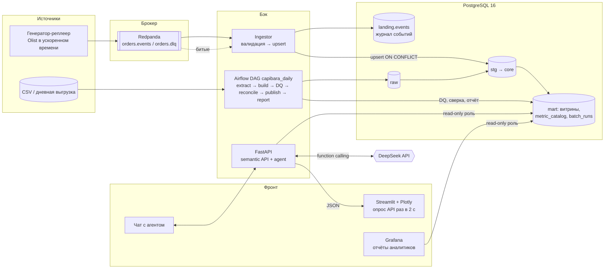

# Capibara Live: план перехода к real-time сервису

Статус: v2, согласовано с командой 2026-10-28. Дополняет `docs/architecture.md` и не ломает его: сборка модели одним SQL-скриптом с нуля (DL-1) остаётся.

**Изменения v2:** BI для аналитиков — **Grafana** (вместо Metabase), агент — **DeepSeek** (вместо Claude), добавлен подробный раздел про ETL pipeline (§5). Остальные решения приняты: генератор-реплеер Olist, Redpanda, Streamlit, FastAPI, Airflow.

## 0. Главная мысль

Просьба «real-time» и просьба «выгрузка раз в день через Airflow» на первый взгляд спорят. Мы их не выбираем, а совмещаем: два пути данных над одной моделью (лямбда-схема с границей по суткам).

| Путь | Что делает | Владеет данными | Истина |
|---|---|---|---|
| **Горячий** (stream) | события заказов сразу попадают в `core`, графики обновляются за 1–3 с | «сегодня» | предварительная |
| **Холодный** (batch, Airflow `@daily`) | ночью пересобирает модель с нуля, прогоняет DQ, сверяет со stream, публикует новую версию | всё до вчера | **окончательная** |

Сказать на защите: «Онлайн-цифры — оперативные, ночная сборка — бухгалтерские. Каждую ночь мы доказываем сверкой, что они совпали».

## 0.1 Обязательный состав → где в плане

| Пункт | Чем закрываем | Раздел |
|---|---|---|
| ETL pipeline | batch: Airflow DAG `capibara_daily` поверх нашего `pipeline/run_etl.py`; stream: генератор → Redpanda → ingestor → `landing` → `core` | §5 |
| API для обращения | FastAPI — API **нашего приложения**: `/api/query`, `/api/metrics`, `/api/status`, `/api/agent`. Фронт и агент ходят только через него | §6 |
| Фронт (рабочий, не обязательно красивый) | Streamlit: live-KPI, интерактивные Plotly-графики, чат с агентом | §7 |
| Инструменты для дашбордов | Plotly в приложении + Grafana (дашборды как код) | §7, §7.1 |
| Отчёты и визуализация для бизнес-аналитиков | Grafana: дашборды D1–D3 из `dashboards.md`, переменные-фильтры, выгрузка CSV, алерты; ежедневный отчёт собирает Airflow | §7.1, §5.3 |

## 1. Откуда «новые данные»: машина времени

Живого источника нет, но в Olist у каждого заказа есть вся хронология: purchase → approved → carrier → delivered → review. **Генератор-реплеер** проигрывает историю 2016–2018 в ускоренном времени (1 день данных = N секунд, настраивается) и публикует события в брокер:

`order.created` (заказ + позиции + покупатель), `payment.captured`, `order.status_changed` (approved/shipped/delivered/canceled), `review.posted`.

Плюсы: данные реальные, контрольные цифры Q1–Q5 сходятся, когда реплей дошёл до конца (это сам по себе тест). Режим «шум»: дубли, события не по порядку, неизвестный продавец. Так корнер-кейсы CC-xx видны вживую.

### 1.1 Демо-режим: история + хвост за ~60 с (принято, заменяет «1 день = 1 с»)

Весь датасет при 1 дне в секунду идёт ~13 мин (774 дня), а защита — 15 мин. Поэтому поток проигрывает **не всё, а только хвост**, а историю до него заранее кладёт ночная сборка. Итог «история + хвост» = весь датасет, значит **финальные контрольные цифры сходятся до копейки**.

| Шаг | Что | Когда | Время |
|---|---|---|---|
| 1. `make demo-prep` | batch-сборка с параметром `cutoff = 2018-08-01`: в модель попадают заказы с покупкой **до** отсечки (со всеми позициями, платежами, отзывами); справочники (товары, продавцы, покупатели, категории) — целиком | до защиты | секунды |
| 2. `make demo-replay` | генератор проигрывает только заказы с покупкой **от** отсечки: все их события, включая доставки и отзывы в сентябре–октябре | на защите | **~60 с** |
| 3. Финал | генератор шлёт `replay.completed`; страница «Контроль» сверяет модель с эталоном | автоматически | мгновенно |
| 4. `make demo-reset` | вернуть модель к состоянию отсечки, чтобы показать ещё раз | по необходимости | секунды |

Размер хвоста (посчитано по `data/`):

| Отсечка | Заказов в хвосте | Из них delivered | Событий | Нагрузка за 60 с |
|---|---|---|---|---|
| **2018-08-01 (реком.)** | 6 532 | 6 351 | ~32 000 | ~540 событий/с |
| 2018-08-15 | 2 488 | 2 414 | ~12 000 | ~200/с |
| 2018-08-22 | 722 | 681 | ~3 500 | ~60/с |

Почему 2018-08-01: это целый месяц, последний в периоде Q1. На демо столбик «август» растёт с нуля до финала, а итоговая выручка доходит ровно до **13 221 498.11**. Хвост полноценный (6,5 тыс. заказов), и нагрузка 540 событий/с — уже настоящий поток, а не игрушка. Отсечка — параметр, её можно сдвинуть.

**Время сжимается под длительность, а не «1 день = N с».** Параметр `--duration 60`: генератор растягивает события хвоста на 60 с, сохраняя их порядок и относительные интервалы. Последние события хвоста растянуты до 2018-10-17, но в сентябре–октябре они редкие. Поэтому пустые промежутки сжимаются до потолка (например, ≤ 0,2 с между событиями), чтобы финал не «тянулся» в тишине.

**Страница «Контроль» после `replay.completed`** — галочки «модель = эталон»: заказов 99 441, выручка Q1 13 221 498.11, топ-продавец Q2 226 987.93, средний чек Q3 159.88, покупатели Q4 96 096 / 3.12 %, сумма категорий Q5 13 221 498.11. Плюс сверка «модель после потока = batch-сборка с нуля без отсечки» по числу заказов и выручке по дням (расхождение 0.00).

**Что это значит для модели:** у batch-сборки появляется параметр `cutoff` в таблице параметров сборки. По умолчанию его нет, и сборка полная, как сейчас: DL-1 и контроли не меняются. Отсечка идёт **по дате покупки заказа**: «старые» заказы лежат в истории уже в финальном статусе, а онлайн приходят новые. Это честное упрощение, его стоит проговорить на защите.

Следствия для реализации: ingestor пишет пачками (до 500 событий в одной транзакции); генератор умеет паузу и рестарт с отсечки. Airflow живёт в реальном времени (`@daily`), на демо — ручной запуск с `ds`.

Полный реплей (`--duration` не задан, 1 день = 1 с, ~13 мин) остаётся как тест-инвариант «поток с нуля = контрольные цифры». Он гоняется в CI или заранее, но не на защите.

## 2. Брокер: Redpanda (принято)

| Вариант | За | Против | Вердикт |
|---|---|---|---|
| **Redpanda** (+ Console) | Kafka API, один контейнер без ZooKeeper/JVM, ~1 ГБ RAM, веб-консоль с топиками и лагом | меньше «узнаваемости», чем Kafka | **выбран** |
| Apache Kafka (KRaft) | стандарт индустрии | JVM, тяжелее на Mac, UI отдельно | запасной: смена брокера = смена адреса, клиент тот же |
| RabbitMQ | простые очереди, хороший UI | нет хранения лога, нельзя «перемотать» поток | нет |
| Redis Streams | очень легко | слабее гарантии и экосистема | только если нет RAM |
| Postgres LISTEN/NOTIFY | ноль новых сервисов | не брокер: нет хранения и гарантий | только сигнал «данные обновились» |
| Debezium CDC | «настоящая» схема «OLTP → Kafka» | Kafka Connect, ещё 2 контейнера | в стратегию развития |

Топики: `orders.events` (ключ = `order_id`, события одного заказа идут по порядку в одной партиции), `orders.dlq` (битые события).

## 3. Архитектура

## 4. База данных: что меняется

1. **Новая схема `landing`** (raw не трогаем): `landing.events(event_id PK, topic, partition, offset, order_id, type, payload jsonb, event_ts, received_at, status)`. Журнал всего, что пришло; из него можно переиграть core.
2. **Факты становятся upsert-able.** Ключи в `core` уже натуральные (`order_id`, `(order_id, order_item_id)`…), поэтому подходит `INSERT … ON CONFLICT DO UPDATE`. **DECISION-3 из architecture.md (суррогатные ключи через `row_number`) отменяем:** с ними поток невозможен без переделки.
3. **Идемпотентность:** брокер доставляет «как минимум один раз», дубли будут. Защита: `event_id` PK в landing и обновление статуса только если `event_ts` новее текущего (поздние события не откатывают заказ назад).
4. **Поздние измерения:** событие с неизвестным продавцом/товаром → строка-заглушка (`is_inferred = true`), потом дозаполняется. Факт не теряем.
5. **Витрины:** сейчас в `sql/60_mart` они `MATERIALIZED VIEW` и сами при upsert не обновятся. Для онлайн-витрин переходим на обычные `VIEW` (при ~100 тыс. заказов это десятки мс), тяжёлые обновляем `REFRESH … CONCURRENTLY` пачкой раз в 2–5 с. Около 10 млн строк понадобятся `MATERIALIZED VIEW … REFRESH CONCURRENTLY` или инкрементальные агрегаты (стратегия: TimescaleDB → RisingWave → ClickHouse).
6. **Неаддитивные метрики** (distinct покупателей, средний чек, доля повторных) всегда пересчитываются из фактов, а не накапливаются счётчиком.
7. **Роли:** `app_ro` (только `SELECT` на `mart`, `statement_timeout=5s`) для API, агента и Grafana; `ingestor` (запись в landing/core); `etl` (владелец схем).

## 5. ETL pipeline

ETL у нас — два конвейера над одной моделью, с общими правилами: одни и те же SQL-файлы `sql/**`, одни и те же DQ-проверки, одна таблица учёта запусков `mart.etl_runs`.

### 5.1 Что уже есть (основа)

`pipeline/run_etl.py` делает полную сборку: ждёт базу → при пустом raw грузит CSV (`scripts/load_raw.py`) → `pipeline/bundle.py` склеивает `sql/00..80` в `dist/build_model.sql` → выполняет его **одной транзакцией** (raw → stg → core → mart → ответы → DQ) → печатает отчёт DQ; в режиме `strict` упавшая проверка откатывает всё. Это ядро batch-пути: Airflow его **не переписывает, а вызывает по шагам**.

### 5.2 Batch: этапы E → T → L

| Этап | Шаг | Вход | Выход | Правило / проверка | При сбое |
|---|---|---|---|---|---|
| **E** Extract | `extract` | дневная выгрузка (в демо: CSV + срез `landing` за `ds`) | файлы в `data/` с манифестом (имя, строки, sha256) | файл есть, число строк > 0, заголовки совпадают с контрактом | ретрай 3×, затем DAG красный, вчерашняя модель живёт |
| **E** Load raw | `load_raw` | CSV | `raw.*` (всё `text`, плюс `_source_file`, `_loaded_at`) | строк в raw = строк в файле (DQ-01) | стоп |
| **T** Staging | `build` ч.1 | `raw.*` | `stg.*` (views) | типизация, `NULLIF(TRIM())`, дедуп, нормализация города/штата | ошибка приведения типа роняет сборку (A-6) |
| **T** Core | `build` ч.2 | `stg.*` | `core.dim_*`, `core.fact_*` | гранулы из architecture.md, unknown-member, только LEFT JOIN, PK/FK | откат транзакции |
| **T** Mart | `build` ч.3 | `core.*` | `mart.v_*`, `metric_catalog`, ответы `qNN_*` | ответы читают только `mart`/`core`, не `raw` | откат |
| **Q** Quality | `dq` | вся модель | `mart.dq_result` | DQ-01..15: число строк до/после JOIN, суммы, уникальность, FK, контрольные цифры Q1–Q5 | `strict`: откат; `report`: публикация с флагом |
| **Q** Reconcile | `reconcile` | batch-модель и stream-состояние за `ds` | `mart.reconcile_result` | число заказов, Σ выручки, Σ платежей по дням; допуск 0.00 | публикация блокируется, алерт |
| **L** Publish | `publish` | новая версия модели | модель видна дашбордам, `mart.etl_runs.status = 'published'` | см. 5.4 | старая версия остаётся |
| **L** Report | `report` | `mart.*` | файл `output/daily/<ds>.html`, плашка в UI | ежедневная сводка для аналитиков | отчёт не блокирует модель |

### 5.3 Airflow DAG `capibara_daily`

- `schedule="@daily"`, `catchup=True`, `max_active_runs=1` (ночные сборки не накладываются), параметр `ds` — симулируемая дата.
- Задачи — тонкие обёртки: `PythonOperator` вызывает функции из `pipeline/` (те же, что `make etl`). Логика в одном месте, Airflow только расписание, ретраи, логи и граф.
- `on_failure_callback` пишет в `mart.etl_runs` и в лог; в Grafana это алерт и красная плашка.
- Отчёт для аналитиков: задача `report` собирает HTML-сводку дня (выручка, заказы, средний чек, доля просрочек, топ-категории, DQ) в `output/daily/`. Тот же DAG — точка, куда потом добавляется рассылка (email/Telegram).
- **Как показать, что работает:** граф DAG в Airflow UI с зелёными задачами и логами; `airflow dags backfill` прогоняет 5 «дней» за минуту; в Streamlit и Grafana плашка «ночная сборка: дата, длительность, DQ 15/15, расхождение stream/batch 0.00» из `mart.etl_runs`.
- Airflow 2.x с `LocalExecutor`, метаданные в той же Postgres (отдельная БД `airflow`), compose-профиль `airflow`: 3 контейнера, ~1.5 ГБ RAM. Почему не Dagster: удобнее, но Airflow сразу узнают эксперт и жюри.

### 5.4 Публикация новой версии без простоя (DECISION-R7)

Сейчас сборка — одна транзакция, которая пересоздаёт объекты в `core`/`mart`. DDL в Postgres транзакционный, поэтому «пустой базы» никто не увидит, но `DROP` берёт эксклюзивную блокировку: дашборды и ingestor **ждут** до `COMMIT`.

| Вариант | Как | За | Против |
|---|---|---|---|
| **A. Как сейчас, в одной транзакции** | на время сборки ingestor ставит паузу (не коммитит offset), потом догоняет из брокера | ноль переделок, история с `make etl` та же | дашборды «замирают» на время сборки |
| B. Теневые схемы | `bundle.py` подставляет `core_next`/`mart_next`, после DQ — `ALTER SCHEMA … RENAME` за миллисекунды | нет простоя, красиво на защите | шаблонизация имён схем в бандле, views надо пересоздавать после rename |

**Принято: A** (сначала измерить время сборки; если < 30 с — хватит), B — улучшение в R5.

### 5.5 Stream: путь одного события

`генератор` → `orders.events` → **ingestor** (consumer group `capibara-ingestor`):
1. проверка по JSON Schema; ошибка → `orders.dlq` с причиной, дальше не идёт;
2. `INSERT INTO landing.events … ON CONFLICT (event_id) DO NOTHING` (дубль не пройдёт);
3. применение к core: upsert факта + inferred-измерения, в той же транзакции;
4. `COMMIT` в Postgres, **после этого** commit offset в Redpanda (at-least-once + идемпотентный upsert = фактически exactly-once);
5. метрики ingestor-а в `mart.stream_status`: событий/с, лаг, последний `event_ts`, число в DLQ.

**Тест-инвариант:** реплей всего датасета через поток даёт те же контрольные цифры Q1–Q5, что batch-сборка с нуля.

### 5.6 Границы горячего и холодного

Batch пересобирает всё до `ds` из raw. Stream пишет события с `event_ts >= ds`. После публикации batch-версии ingestor переигрывает из `landing` события «сегодня» поверх новой модели (журнал — источник истины для догоняния).

## 6. API (FastAPI, расширяем `app/`)

Центр всего — **семантический слой**: `mart.metric_catalog` плюс разрешённые измерения. Метрика описана один раз (код, формула, гранула, аддитивность, допустимые срезы), и Streamlit, и агент, и подписи в Grafana берут её отсюда.

| Эндпоинт | Что |
|---|---|
| `GET /api/metrics` | каталог метрик и измерений |
| `POST /api/query` | `{metric, group_by[], filters{}, grain, date_from, date_to}` → JSON-ряды. SQL собирается из каталога, параметры только через bind, имена из whitelist |
| `GET /api/status` | лаг потока, событий/с, последняя ночная сборка, DQ, сверка |
| `POST /api/agent` | чат: вопрос → ответ + `chart_spec` |
| `GET /health` | уже есть |

## 7. Фронт: Streamlit + Plotly (принято)

| Вариант | Live | Интерактив | Чат | Код | Вердикт |
|---|---|---|---|---|---|
| **Streamlit** + Plotly | `st.fragment(run_every=2s)` | зум, hover, выбор точек → фильтр | `st.chat_input` из коробки | минимум | **выбран** |
| FastAPI + Jinja + Plotly.js + HTMX | SSE | полный cross-filter | писать на JS | больше | запасной |
| Plotly Dash | `dcc.Interval` | лучший cross-filter | собирать самим | средне | нет |

Streamlit — отдельный сервис-клиент: ходит в FastAPI, в базу напрямую **не** ходит. Страницы: «Продажи», «Доставка и отзывы», «Покупатели», «Live» (событий/с, лаг, последние заказы), «Спросить агента», «Качество данных» (DQ, ночная сборка, сверка). Фильтры в сайдбаре: период, штаты, категория, гранула, определение выручки; у каждого графика «Скачать CSV». Честные ограничения: только опрос, а не push; каждое действие перезапускает скрипт (лечится `st.cache_data` и fragment). ASSUMPTION-R3: в R0 сверить по документации актуальной версии Streamlit `st.fragment(run_every)` и `on_select` у `plotly_chart`.

### 7.1 Grafana для бизнес-аналитиков (принято)

Grafana — промышленный стандарт, команда её знает, концепция D1–D3 уже описана в `dashboards.md`.

- **Подключение:** datasource PostgreSQL под ролью `app_ro`, только `mart.*`.
- **Дашборды как код:** provisioning — datasource и JSON дашбордов лежат в `dashboards/grafana/`, поднимаются сами при старте контейнера; правки через UI экспортируются обратно в git.
- **D1 «Продажи», D2 «Доставка, SLA и отзывы», D3 «Покупатели и удержание»** — по `dashboards.md`; плюс **D4 «Pipeline»**: статус ночных сборок, DQ, сверка stream/batch, лаг и событий/с потока.
- **Фильтры:** template variables (период, штат покупателя/продавца, категория, гранула) подставляются в SQL панели.
- **Live:** авто-обновление дашборда 5 с; на D4 видно, как идёт поток.
- **Неаддитивные метрики** считаются в SQL панели под нужный срез, а не суммированием в трансформациях Grafana (типичная ловушка, вопрос защиты).
- **Отчёты аналитикам:** выгрузка данных панели в CSV (Inspect → Data), алерты (просрочки > порога, DQ упал, лаг > N), ежедневный HTML-отчёт из Airflow (§5.3). Рассылка PDF по расписанию в Grafana — функция Enterprise/Cloud, в OSS её нет, поэтому её роль выполняет Airflow (ASSUMPTION-R4: проверить по документации текущей версии).
- **Кто где:** Streamlit — «приложение» для демо, агента и live; Grafana — рабочий инструмент аналитиков и мониторинг pipeline.

## 8. Агент «построй мне график»: DeepSeek

Принцип: **LLM не пишет SQL и не трогает БД.** Он выбирает метрику, срез и фильтры из каталога через function calling, запрос строит наш код.

1. Пользователь: «покажи выручку по штатам продавцов за 2018, только электроника».
2. **DeepSeek через Yandex AI Studio** (сверено по документации Yandex Cloud и DeepSeek API через Context7, 2026-10-28):

   | Параметр | Значение | Источник |
   |---|---|---|
   | Endpoint (OpenAI-совместимый) | `https://ai.api.cloud.yandex.net/v1` | Yandex Cloud docs |
   | Модель | URI `gpt://<folder_id>/deepseek-v4-flash` | Yandex Cloud docs (пример LiteLLM) |
   | Аутентификация | API-ключ сервисного аккаунта, в переменной **без** префиксов `Bearer`/`Api-Key`; `folder_id` передаётся в `project` клиента | Yandex Cloud docs |
   | Клиент | `openai` SDK: `OpenAI(api_key=…, base_url=…, project=folder_id)`, `chat.completions.create(model=URI, tools=…)` | Yandex Cloud docs |
   | Function calling | у DeepSeek поддерживается (`tools`, тип `function`, имя `[a-zA-Z0-9_-]{≤128}`); через Yandex endpoint в документации показан на YandexGPT | DeepSeek docs / Yandex docs |
   | Режим thinking | у DeepSeek V4 включён по умолчанию; при вызове инструментов в этом режиме `reasoning_content` надо возвращать в историю сообщений | DeepSeek docs |

   **«DeepSeek 4.1» в документации нет.** Актуальное семейство — V4: в оригинальном API это `deepseek-flash` и `deepseek-v4-pro`, в Yandex AI Studio подтверждён `deepseek-v4-flash`. Берём **`deepseek-v4-flash`**; есть ли в AI Studio `deepseek-v4-pro`, проверить в консоли (ASSUMPTION-R5).

   Конфиг в `.env` (ключ не в git): `LLM_BASE_URL`, `YANDEX_AI_STUDIO_API_KEY`, `YANDEX_FOLDER_ID`, `LLM_MODEL=deepseek-v4-flash`. Провайдер скрыт за адаптером `app/agent/llm.py`: переход на оригинальный DeepSeek API или YandexGPT = смена трёх переменных.

   **Smoke-тест в R0** (`tests/agent/test_llm_smoke.py`, пропускается без ключа): один запрос с одним инструментом через Yandex endpoint → модель вернула `tool_calls` с валидным JSON. Проверяем и то, что Yandex пропускает параметр `thinking`/`reasoning_effort`; если нет — работаем без thinking.
3. Инструменты:
   - `list_metrics()` → каталог;
   - `query_metric(metric, group_by, filters, grain, date_range)` → тот же `/api/query`;
   - `make_chart(type, x, y, series, title)` → наша ограниченная спека (bar/line/area/pie/table/map), бэкенд превращает её в Plotly.
4. Ответ: график в чате + одна фраза-вывод + раскрываемый блок «как посчитано» (метрика, формула из каталога, фильтры, SQL). Закрывает критерий «ИИ: прозрачность и проверка».
5. Защита от ошибок: неизвестная метрика/срез → инструмент возвращает ошибку со списком допустимых, агент переспрашивает; неаддитивную метрику нельзя сложить по срезам; read-only роль, таймаут, лимит строк; аргументы инструментов валидируются pydantic-схемой (ответы LLM не доверяем без проверки).
6. «Закрепить на дашборд»: спека сохраняется в `mart.saved_charts` и появляется на странице Streamlit.
7. Fallback без сети/ключа: разбор по ключевым словам на 10 типовых запросов.
8. Данные: в LLM уходят только имена метрик и агрегаты, персональных данных в датасете нет; ключ API только в `.env`, не в git.

Свободный text-to-SQL отвергаем для MVP: правильность цифр не гарантировать.

## 9. Инфраструктура (docker compose)

Новый `docker-compose.realtime.yml` поверх существующих (кейсовый compose не меняем), профили:
- базовый: `postgres`, `etl`, `app` (FastAPI :8000), `web` (Streamlit :8501);
- `bi`: `grafana` (:3000, provisioning из `dashboards/grafana/`);
- `realtime`: `redpanda`, `redpanda-console` (:8081), `generator`, `ingestor`;
- `airflow`: `airflow-init`, `airflow-scheduler`, `airflow-webserver` (:8082).

`make live` — база + поток + приложение; `make bi`; `make airflow`; `make demo-full` — всё. RAM ~5 ГБ, Docker Desktop ≥ 6 ГБ.

Новые папки: `stream/` (generator, ingestor, schemas), `airflow/dags/`, `app/api/`, `app/agent/`, `web/` (Streamlit), `dashboards/grafana/`, `sql/05_landing/`, `tests/stream/`, `tests/agent/`.

## 10. Этапы

| Этап | Что | Блок | Зависит от | Риск | Демо-эффект |
|---|---|---|---|---|---|
| **R0** | Контракты: JSON Schema событий, `metric_catalog` (15–20 метрик), `chart_spec`, `etl_runs`; сверка версий Streamlit/Grafana/DeepSeek | все | — | низкий | — |
| **R1** | `/api/query` + Streamlit с Plotly и фильтрами; Grafana D1–D3 через provisioning | Бэк+Фронт | R0 | низкий | средний |
| **R2** | Redpanda + генератор + ingestor + `landing` + upsert + live-страница | БД+Бэк | R0 | **средний** (порядок, дубли) | **высокий** |
| **R3** | Агент DeepSeek: function calling над `/api/query`, чат, «как посчитано» | Бэк+Фронт | R1 | средний (сеть, ключ) | **высокий** |
| **R4** | Airflow DAG: extract → build → DQ → reconcile → publish → report; Grafana D4 | Бэк+БД | R2 | средний (RAM) | средний |
| R5 | Режим «шум», DLQ в UI, теневые схемы (5.4-B), нагрузка ×10 | все | R2, R4 | низкий | средний |

После R0 этапы R1 и R2 параллельны (разные файлы: `app/`, `web/`, `dashboards/` против `stream/`, `sql/05_landing/`). R3 — после R1, R4 — после R2. TDD: тесты идемпотентности ingestor (повтор, не по порядку), инвариант «реплей = контрольные цифры», валидация аргументов агента — пишутся до кода.

## 11. Риски

| Риск | Чем закрываем |
|---|---|
| Распыление: много новых технологий | этапы независимы и демонстрируемы по отдельности; минимум R1+R2 |
| Mac не тянет всё сразу | профили compose, Airflow поднимаем только для показа |
| Поток ломает «сборку с нуля» | batch-путь не меняется; тест «реплей = контрольные цифры» |
| Stream и batch разошлись | reconcile в DAG, расхождение видно в Grafana D4, публикация блокируется |
| Агент «галлюцинирует» цифры | только каталог + function calling, валидация аргументов, показ SQL |
| Нет сети или DeepSeek недоступен | fallback-парсер, записанное видео демо |

## 12. Решения и допущения

Приняты: R1 Redpanda · R2 Airflow · R3 Streamlit + Plotly · R4 агент только через семантические tools · R5 демо-реплей: история до 2018-08-01 batch-ом + хвост потоком за ~60 с (§1.1) · R6 Grafana для аналитиков · R7 вариант A (одна транзакция, пауза потока) · LLM `deepseek-v4-flash` через Yandex AI Studio.

Открыты:
- **ASSUMPTION-R1:** на площадке есть интернет, у сервисного аккаунта есть API-ключ и доступ к AI Studio в каталоге `YANDEX_FOLDER_ID`.
- **ASSUMPTION-R2:** Docker Desktop может получить ≥ 6 ГБ RAM.
- **ASSUMPTION-R3:** API Streamlit (`fragment`, `on_select`) — проверить в R0.
- **ASSUMPTION-R4:** в Grafana OSS нет рассылки PDF-отчётов по расписанию — проверить в R0.
- **ASSUMPTION-R5:** `deepseek-v4-flash` в AI Studio отвечает с `tool_calls`; наличие `deepseek-v4-pro` — проверить в консоли (smoke-тест R0).
- `dashboards.md` уже выбирает Grafana; `architecture.md` DECISION-3 (суррогатные ключи) теперь противоречит §4.2 — поправить при старте R0.
